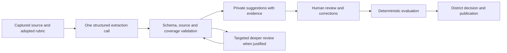

# AI analysis modernization plan

Updated October 16, 2026. The owner authorized implementation and provider portability. The first
local modernization package is implemented; no live provider calls or deployments are included. This prioritizes prompt/analysis infrastructure before broad card/detail
restyling, following the owner's direction. UI work should expose the resulting intelligence clearly.
Read alongside [the original source review](prompt-intelligence-review.md) and
[the reliability requirements](design-continuity-plan.md).

## Independent review checkpoint

Five independent agents tested the implemented contract and review path on October 16, 2026.
Their shared diagnostic exercise accepted 30/35 first attempts; all five failures came from the
same contradiction/uncertainty mismatch. Specialized probes exposed source, state, review-context,
worker and future settlement gaps. Agreement is not an accuracy result.

[The refinement report and design](ai-analysis-refinement.md) now define the next implementation
order and acceptance gates. Repair those demonstrated boundaries and adjudicate the rubric before
a live-provider comparison. The checkpoint below records what was implemented; it does not imply
that every desired reliability property has passed adversarial testing.

The first approved refinement step is implemented in [analysis invariants](analysis-invariants.md).
It fixes canonical text, state compatibility and whole-worker deadlines while preserving v1 history.
Preserving review qualifications through the editor is the next implementation step.

## Intended outcome

Produce a useful, cited first review of a policy: what it promises, what it leaves unresolved,
which exceptions matter, and what the district needs to verify. Reduce API cost, latency and human
correction effort while preserving deterministic scores, attributed corrections and independent
district decisions. Model capability alone does not establish reliability for this workload.

Use a small provider interface. Acknowledge that the original prompt system was designed around
Gemini, while allowing any hosted or local system that passes the contract and evaluation gates.
Gemini and OpenAI are examples for comparison, not a required pair or a closed provider list. Each installation should need only its chosen provider; do not require
two subscriptions or send district context to a second provider without explicit configuration.

## Current capabilities that change the design

The following official documentation was checked on October 16, 2026. These are available design
options, not evidence of PrivacyPal accuracy or account-specific availability. Recheck endpoint,
model, SDK, pricing and retention compatibility before the benchmark.

| Capability | Planned use |
| --- | --- |
| Schema-constrained responses | Define one canonical typed output contract with provider-specific schema translation. Independently validate evidence and meaning; schema validity alone is insufficient. [OpenAI](https://developers.openai.com/api/docs/guides/structured-outputs), [Gemini](https://ai.google.dev/gemini-api/docs/structured-output). |
| Adjustable reasoning | Compare reasoning effort on the same cases. Reserve deeper review for ambiguity and exceptions when measurements justify it. Output-token limits must account for reasoning as well as final JSON. [OpenAI](https://developers.openai.com/api/docs/guides/reasoning), [Gemini](https://ai.google.dev/gemini-api/docs/thinking). |
| Prefix/context caching | Keep reusable instructions and adopted definitions stable; append changing source/task content. Measure cache hits and actual charges. OpenAI's newer models expose explicit breakpoints; Gemini Interactions uses implicit caching. Do not assume identical controls across providers. [OpenAI](https://developers.openai.com/api/docs/guides/prompt-caching), [Gemini](https://ai.google.dev/gemini-api/docs/caching). |
| Discounted asynchronous batches | Use supported batch endpoints for non-urgent benchmark runs. Both providers document discounted processing; support depends on model/API, and Gemini's batch guide currently specifies generateContent. Interactive review does not wait for a batch. [OpenAI](https://developers.openai.com/api/docs/guides/batch), [Gemini](https://ai.google.dev/gemini-api/docs/batch-api). |
| Stronger reasoning and larger context | Compare current model families; later evaluate complete policy/education-terms bundles with explicit document scope. Bigger context does not establish complete or correct evidence coverage. Current candidates include GPT-6.1 Sol / GPT-6 Astra and Gemini 3.8 Flash / Gemini 4 Argon. These are candidates, not selected defaults. [OpenAI catalog](https://developers.openai.com/api/docs/models), [Gemini latest model](https://ai.google.dev/gemini-api/docs/latest-model), [Gemini thinking/model table](https://ai.google.dev/gemini-api/docs/thinking). |

## Proposed pipeline

The deeper-review edge has a hard attempt and spend limit; it is not an open-ended loop. Start by
benchmarking a strong single call against a less expensive call plus selective escalation. Do not
assume a chain of models is cheaper or more accurate. Logical stages need not be separate API calls.

### Source and context preparation

- Keep captured text immutable and identify it by hash. Begin with the existing single pasted
  synthetic source and 32,000-code-unit cap. Do not silently truncate longer text.
- Assign stable paragraph/section IDs with offsets into the exact saved text. Ask the model for
  source IDs and quotes; resolve and validate offsets on the server. Reject ambiguous matches;
  test repeated passages and Unicode instead of relying on model character counting.
- Generate measure definitions from the adopted evaluation contract. Avoid maintaining a separate
  hardcoded 50-measure prompt. Disabled measures and their effects remain explicit.
- Separate vendor source, district context and evaluation instructions. Mission/branding prose
  should not change a factual extraction. Use optional narrative context only where it serves the
  explanation; rubric definitions and documented interpretive guidance remain versioned.
- The saved law/standard selections are references, not a complete legal corpus. Any future legal
  question module needs adopted, sourced and versioned requirements rather than model memory.

### Prompt and output contract

Maintain small versioned modules: evidence extraction, targeted ambiguity review, and concise
explanation. Use direct task goals, permitted evidence and a few examples of difficult distinctions.
Remove repeated instructions, model-generated scores and lengthy duplicated schema prose. Request
concise evidence-based rationales rather than a transcript of internal reasoning.

Each suggestion should carry its measure ID, proposed assessment, supporting/contradicting citation
IDs, scope/conditions, short rationale, unresolved question and a categorical uncertainty reason.
Distinguish explicit support, partial support, contradiction, ambiguity, absence in reviewed source,
unavailable source and incomplete extraction. Missing response fields must never become policy silence.
Policy promises are claims in a document, not verification of vendor conduct.

Store source/context/definition hashes, prompt and schema versions, model identifier, supported
model revision metadata, generation settings, attempt ID, timestamps, provider request ID and usage.
Record the actual returned suggestions so history survives model changes; rerunning the same prompt
does not guarantee identical output. Do not store hidden reasoning or secrets.

The extraction request has no browsing, write tools or publication authority. Treat embedded source
instructions as untrusted text. Schema validation, allowlists, provenance checks and authorization
must enforce the boundary independently of prompt wording.

### Sophistication with useful limits

Resolve exceptions, qualified commitments, account types, student/adult scope, consumer/education
terms and conflicting passages. Generate specific follow-up questions tied to the missing evidence,
such as whether a deletion exception applies to school-managed accounts. Suggested summaries must
link their claims to validated findings and retain their caveats.

Route deeper review using observable signals: conflicting passages, uncertain document scope,
critical ambiguities, failed support checks or reviewer requests. Model confidence is not a
calibrated probability. Sample apparently clear cases during evaluation to test whether the routing
misses confidently wrong answers. A second model's agreement is not independent proof.

Keep district tier, support, DPA confirmations, permitted use, consent, decisions and publication
human-owned. Suggestions can inform these fields but cannot set them. Preserve the requirement for
explicit review of every enabled measure. Removing that requirement would be a separate decision.
Neither model scores nor rubric percentages may produce a legal compliance certification.

## Work sequence and completion gates

| Step | Deliverable | Complete when |
| --- | --- | --- |
| 1. Establish evaluation cases | Authored synthetic policy set, expected findings/evidence, failure taxonomy and scoring report specification | Cases distinguish clear commitments, omissions, exceptions, conflicts, education scope, unreadable sources and injected instructions; labels are reviewed before model comparison |
| 2. Define the contract and prompts | Canonical suggestion schema, prompt modules/manifest, source-reference resolver and offline adapter | Duplicate/missing IDs, invented quotes, invalid enums, wrong source scope, oversize output and truncation cannot enter a completed suggestion set; representative prompt snapshots are reviewable |
| 3. Build reliable orchestration | Server-only provider boundary, bounded job state, cancellation/reconciliation, usage accounting and private version storage | Slow/failed/uncertain requests, duplicate delivery, crash/restart, access revocation, maintenance and stale completion preserve corrections and publication; new records survive backup/restore |
| 4. Benchmark current models | A bounded synthetic comparison of a strong single call, a lighter call and a selective-review variant | Accuracy, critical errors, reviewer effort, repeatability, cold/warm cost and latency are compared on held-out cases; default/alternative selected from observed results |
| 5. Integrate one complete service | Cedar walkthrough with cited suggestions, targeted questions and review controls across the existing four tabs | Owner can inspect evidence, correct a suggestion, see deterministic recalculation, record a fresh decision and verify publication withdrawal/republication |
| 6. Expand sources and intelligence | Separately versioned multi-document capture, scope/conflict analysis and later policy-change comparison | Document provenance/precedence is explicit, citations survive normalization, storage and recovery limits are validated, and accuracy is measured before enabling new source types |

Steps 1–3 start offline with synthetic inputs and responses. Model/API enablement is a later,
deliberately scoped step: choose provider/account, permissible data and a total benchmark spending
cap before any billable request. This plan does not authorize calls. UX exploration can use recorded
synthetic suggestions while orchestration is built.

## Efficiency experiments

1. **Compact output:** return only machine-consumed fields, shared citation references and short
   rationales. Reuse validated findings for explanations rather than repeatedly analyzing the policy.
2. **Fewer calls:** start with one request covering the adopted measures; compare grouped extraction
   only if full-rubric accuracy or output completeness requires it. Count retries and escalations.
3. **Reasoning selection:** establish a quality reference with a capable model, then reduce effort
   or model size until a measured quality gate fails. Do not infer reliability from low temperature.
4. **Two distinct caches:** provider prefix caching reduces repeated input processing; a district-local
   result cache can avoid an entire request when source, context, contract, prompt, model and settings
   match. Reused output remains a suggestion and never restores approval. Recheck access on reads.
5. **Incremental work:** recompute deterministic scores without AI when applicable. Future source
   changes may reuse unaffected extraction only after dependency and cross-document exception tests;
   a text diff alone cannot prove a finding remains valid.
6. **Measure real usage:** record input, cached input, output and reasoning usage where exposed,
   duration, retries, routing and dated pricing. Report cost per completed usable review and reviewer
   correction minutes, not just cost per request. Include uncached first-use and sporadic district use.

Do not pad requests solely to qualify for caching. Do not introduce embeddings, a vector database,
fine-tuning, a multi-agent framework or broad autonomous research unless measured failures justify
the extra system. Retrieval-only evidence can miss exceptions elsewhere in a policy; test that risk
before using it to claim an omission. Current source limits remain until a reviewed expansion.

## Evaluation and release criteria

Start with about 40 authored synthetic source cases, split into development and sealed holdout sets,
plus independent malformed-response and job-failure fixtures. Cover all enabled measures across the
set, including polarity, definitions, exceptions and scope. Repeat the difficult cases to measure
variation. Expand after reviewing baseline errors. Expected findings should be human-reviewed;
model-generated examples and model graders can assist but cannot be the sole source of truth.
This follows task-specific, continuous evaluation guidance. [OpenAI evaluation practices](https://developers.openai.com/api/docs/guides/evaluation-best-practices).

Track per-measure precision/recall, false assurances, contradiction recall, omission/unknown confusion,
citation validity and support, schema completion, unnecessary escalation, repeated-run disagreement,
human corrections, end-to-end latency and total cost. Report denominators and results by case type;
an overall average must not hide poor performance on critical findings.

Hard software gates: every accepted citation resolves exactly, IDs match the adopted contract, failed
or incomplete jobs stay incomplete, server calculations remain reproducible, and machine output cannot
write human decisions. No introduced critical false-assurance case may remain unresolved in the
holdout before promoting a candidate. Zero observed critical errors in a small set is not a claim of
zero real-world risk. Set numeric quality and cost thresholds after the labeled baseline, before
choosing the winner; do not tune thresholds to a preferred model.

Use `npm run ci` and `npm run test:integration` for relevant implementation/authorization changes,
plus recovery rehearsal for new persisted formats. Provider-dependent evaluations remain explicitly
invoked and budgeted; ordinary CI stays offline and deterministic. Model/prompt changes rerun the
same evaluation gates, produce an error diff and never rewrite historical assessments automatically.

## Storage, job and operating requirements

The existing worker is a 500 ms fixture poller with a 30-second lease and attempt-count quota.
It is a useful local starting point, not a complete live inference worker. Add renewable leases,
bounded concurrency, deadlines, provider status reconciliation where available and a reservation
ledger for spending. A client timeout does not prove the provider did no work; unknown outcomes must
not trigger blind duplicate billable requests. Best-effort cancellation may not prevent incurred cost.

Separate transient transport failures from invalid input, refusal, truncation and structurally invalid
output. Bound retries and any repair/escalation call within the same reservation. Recheck authority
before dispatch and commit; late results cannot overwrite a newer human evaluation. Retain the
existing receipt/revision and atomic publication semantics.

Define byte caps and retention for job attempts, suggestions and usage. Extend installation backup
schema/version support before persisting new record kinds; test mixed-version restore and rollback.
Preserve current 8 KiB heads, paged reads and bounded detail responses. Keep credentials server-side,
source-bearing logs private and minimal, provider retention/cache settings explicit, and one district's
sources, context and results isolated from others. Real-data hosting remains a separate milestone.

## First implementation package

Deliver steps 1 and 2 first: the reviewed synthetic cases, canonical suggestion contract, generated
prompt preview, citation/coverage validators and an offline comparison report. Include one mocked
Cedar result showing a commitment, an exception, an omission and a targeted follow-up question.
This makes the intended intelligence concrete before spending on model evaluation or restyling the
whole interface. Then complete the live-job reliability work and a budgeted provider comparison.

## Implementation checkpoint

Implemented: versioned canonical requests and strict output/citation/coverage validation; stable
source passages; a server-only provider interface; recorded Cedar suggestions for eight or 50
adopted measures; request receipts, exact-result caching, renewable leases, deadlines, cancellation,
stale-result/access/maintenance fencing; bounded private results; schema-5 backup support; and a
Compliance-tab workflow that opens suggestions as editable evidence drafts. No automatic scoring,
reviewer attribution, district decision or publication comes from model output.

The 40 authored synthetic development cases and offline export/grading command are present. Their
labels still need independent human review. They cover the eight practice measures and common
edge cases, not a complete 50-measure model benchmark or a sealed holdout.

Read [provider adoption](ai-provider-adoption.md) for porting to any AI system and
[local suggestion workflow](policy-suggestions.md) for operation and limits. Live provider
registration, priced budgets/operator reconciliation, model comparison, deeper review routing and
multi-document extraction remain subsequent milestones. No speed, cost or semantic-quality gain
is claimed from the offline recording.
