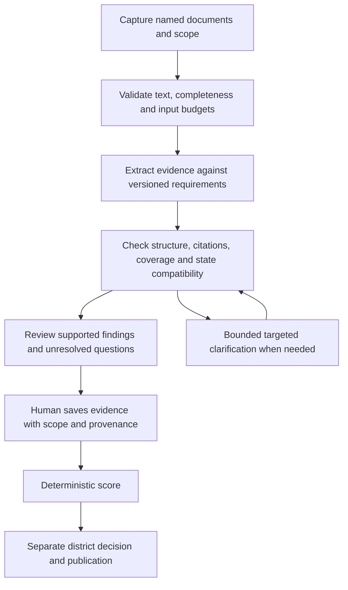

# AI analysis refinement after five independent reviews

October 16, 2026. **Proposed next milestone:** repair evidence and review-state boundaries, clarify the adopted rubric, then evaluate complete policies before enabling a live provider. The current extraction architecture is worth keeping. More elaborate prompts alone will not correct the observed failures.

This report refines [the modernization plan](ai-analysis-plan.md), [provider adoption](ai-provider-adoption.md) and [the suggestion workflow](policy-suggestions.md). The independent review proposed these changes; the implementation checkpoint below records subsequent work. Gemini remains acknowledged as the original design, and qualification remains open to any hosted or local system that satisfies the same evidence and operating contract.

## Approved implementation checkpoint

The owner approved the next milestone. The first implementation step is now documented in
[analysis invariants](analysis-invariants.md): canonical text and forward progress, compatible
finding states with versioned historical reads, and bounded worker operations/cleanup. The
observations below describe the pre-fix review and remain unchanged as evidence. Subsequent
[review-context implementation](review-context.md) now completes step 2: durable qualifications,
server-verified provenance, unresolved coverage, full rubric definitions and structured overviews.
The [rubric precision packet](rubric-precision.md) supplies 14 proposed measures, 26 explicit
subrequirements, 91 synthetic cases, and a provider-neutral offline export/grading runner.
The owner's continuation authorized a separately selectable [precision pilot](rubric-adoption.md):
versioned clause extraction, deterministic aggregation, human correction and schema-7 recovery.
The default and saved historical reviews remain unchanged. Labels are still provisional; the
remaining 36 measures have not undergone precision review. The first bounded pasted
[source-bundle increment](source-bundles.md) adds immutable manifests, server-owned coverage,
v4 qualification contracts and schema-8 recovery. The subsequent [long-policy increment](source-segments.md) adds bounded source parts, offline
segment attempts and complete-source synthesis, human range acknowledgments and schema-9 recovery;
independent adjudication and live-provider qualification remain separate work.

## Study design and limits

Five agents began with fresh context and separate assignments: source integrity, semantic precision, adversarial contract testing, provider lifecycle, and human review. They ran in two waves because only three subagents could run concurrently. Each received the same frozen seven-case synthetic pack containing production-generated instructions, schema and adopted criterion definitions: 17 requested findings per agent, 85 judgments in total.

Agents preserved their first outputs before running the actual validator, then saved corrections separately. They were instructed not to read each other's results or previous assistant interpretations. Specialized probes exercised actual production helpers using synthetic data. Lifecycle tests used an in-memory service stub; component tests used server rendering, not a browser interaction study. No district data, live provider endpoint, credentials, emulator records or production deployment were used.

Independence here means separate context and authored assessments within the same model family. It does not establish independent expertise, cross-provider performance, human agreement, measured API cost or semantic accuracy. Seven cases are a diagnostic exercise, not a complete 50-measure benchmark. Parent-authored provisional labels were frozen but are not a gold standard; disagreements were retained for adjudication.

## What the common exercise found

| Review | First attempt accepted | Separate corrected attempt | Specialized evidence |
| --- | ---: | ---: | --- |
| Source integrity | 6/7 | 7/7 | Source capture, Unicode, segmentation, request size and provenance probes |
| Semantic precision | 6/7 | 7/7 | 14 synthetic validation probes and 12 difficult criterion groups in existing public-policy captures |
| Adversarial contract | 6/7 | 7/7 | 42 crafted contract probes; existing analysis unit tests |
| Provider lifecycle | 6/7 | 7/7 | 16 deterministic service-stub probes; existing analysis unit tests |
| Human review | 6/7 | 7/7 | Seven helper probes, five component render checks and 50 existing focused unit tests |
| **Total** | **30/35** | **35/35** | Counts describe acceptance, not correctness |

All five rejected case responses failed the same rule: an explicit advertising contradiction was reported with no uncertainty. The instructions request a question when unresolved, while the runtime validator requires nonzero uncertainty and a question for every non-supported result. The corrections changed only uncertainty and, in four responses, the question. They changed no assessment states or citations. The higher corrected acceptance rate is not an improvement in substantive interpretation.

The agents agreed on **16 of 17 finding states**. Four called request-dependent termination deletion contradicted; one called it partial. The criterion bundles termination, request authority, timing and final disposal without a sufficiently explicit aggregation rule. In a separate cross-site tracking case, all five chose partial while the parent's provisional label was contradicted. Inspection found overlapping partial/failure definitions, with partial a defensible reading. Majority vote cannot resolve either rubric problem.

All five distinguished a failed capture from policy silence, kept school-managed accounts separate from independent adult accounts in the supplied case, and ignored the embedded instruction to award full support. These are useful observed successes with one case of each kind, not broad resistance or accuracy estimates.

## Reproduced failures and design implications

| Boundary | Observation and reachability | Required refinement |
| --- | --- | --- |
| Source segmentation | A lone high surrogate immediately before a newline causes the actual request builder to loop without advancing. The input schema accepts that string. Reproduced in timeout-isolated processes; an HTTP exploit was not tested. | Reject ill-formed text and guarantee loop progress before broader source ingestion. |
| Source identity | Two different malformed UTF-16 strings produce identical UTF-8 replacement bytes and therefore the same source hash. A quotation-free result can pass the changed-source check. This is an encoding ambiguity, not a cryptographic hash collision. | One validated canonical-text representation for input, hashing, passage creation and validation. |
| Input efficiency | A 32,000-unit source with 16,000 tiny lines generated 16,000 passages and an 830,075-byte serialized single-measure request. Only source length and output size are bounded. | Bound passage count and request bytes/tokens; package coherent passages instead of one object per physical line. |
| State consistency | `supported` with `missing_source`, conflict or ambiguous wording can validate; conversion prepares a yes draft. Clear contradiction with no uncertainty is rejected. | Separate assessment from uncertainty and define enforceable compatible combinations. |
| Source readiness | An explicitly incomplete excerpt can be labeled usable by the model and accepted as evidence of omission. A global incomplete status also blocks independently supported draft preparation. | Server-owned document manifest and per-requirement readiness/coverage. |
| Evidence meaning | Exact but irrelevant, opposite-polarity or wrong-account quotes can pass. Summary text with a valid measure ID can assert legal compliance, agreement facts or publication advice. | Distinguish quote integrity from semantic support; constrain summary claims and retain human review. No automated publication bypass was demonstrated. |
| Review handoff | Scope, uncertainty and follow-up questions are shown in the suggestion panel but omitted by the draft conversion and saved-finding contracts. A qualified finding can become an unqualified saved human interpretation unless the reviewer manually repeats the caveat. | Persist qualifications and provenance, require explicit resolution or retention, and show every rubric outcome definition. |
| Unresolved human review | The editor offers no unavailable/ambiguous state. Helpers allow a failed capture to be manually recorded as reviewed policy silence. | Keep unresolved work distinguishable from a confirmed omission, without silently changing historical score semantics. |
| Worker deadline | A 10 ms configured deadline did not end a worker blocked on identity lookup after 80 ms; it completed only when lookup was released. This path exists in the offline worker. | Bound the whole operation, including identity/preflight/commit, and fence late writes. |
| Queue upgrades | Twenty incompatible queued jobs before an eligible job exhaust the query window, leaving the compatible job unprocessed. | Select eligible jobs before limiting, paginate, or explicitly park obsolete work. |
| Live settlement | Fake paid-style completed, rejected or stale jobs can retain unknown-cost reservations after leaving the reconciliation query. Shipped requests cannot enable a paid provider. | Reconcile dispatch/billing independently of result acceptance; do not release unknown charges or resend blindly. |
| Historical results | A manually substituted definition with the same measure IDs can leave old output readable as succeeded under a new definition. Normal UI does not expose that replacement. | Preserve and validate against the original immutable request manifest; explicitly mark compatibility after upgrades. |
| Evaluation | The current grader checks only the first finding. A multi-measure response with a wrong later finding can report correct with no false assurances. Existing development cases are single-measure, so their accounting is not invalidated. | Grade a per-measure expected map or reject multi-measure cases until supported. |

Relevant implementation boundaries are [request construction and validation](../server/analysis/contract.ts), [suggestion conversion](../shared/assistance.ts), [input/finding contracts](../shared/review.ts), [the worker](../server/analysis/jobs.ts), [the benchmark grader](../server/analysis/benchmark.ts), [the suggestion panel](../src/AssistancePanel.tsx) and [the evidence editor](../src/EvidenceEditor.tsx).

The source reviewer also tested the two previously captured edtech texts against the real input
boundary: the Seesaw capture (25,372 UTF-16 units) fit; the Blooket capture (60,530 units) was
rejected by the 32,000-unit cap. That is a deliberate limit, not silent truncation. These counts
include a trailing newline. They confirm that complete long-document handling is needed before
claiming a general two-company workflow; they do not establish current policy completeness or
vendor compliance. The prior laboratory bypass is not evidence that the shipped path supports it.

## What should be preserved

The tests confirmed exact citation/source checks, duplicate and missing measure rejection, output bounds and strict rejection of unauthorized structured fields. The lifecycle probes confirmed exact-result reuse, cancellation/access/stale-result fencing, renewable leases and once-only settlement when cost is known. Draft tests preserved original revisions, blocked stale saves and kept uncertain command identity; existing drafts prevent suggestion replacement. Suggestions do not themselves update saved human evidence, deterministic scores, district decisions or public projections.

These successes justify retaining the current separation of extraction, human review, deterministic evaluation and district authority. Extend those boundaries to qualifications, source completeness and settlement rather than replacing the workflow.

## Recommended architecture

Keep the Gemini provenance and vendor-independent adapter. Use the five-agent exercise as a development review technique. A production review should start with one bounded extraction request and escalate only an identified ambiguity when evidence shows that doing so helps. This study does not establish the cost or accuracy of a five-agent production pipeline.

These are logical boundaries, not a requirement for a separate model call at each box. Transport, billing and source coverage have their own durable states.

### 1. Make source readiness an application responsibility

Create an immutable source-set manifest before inference. For each document record its identity, URL/upload label, retrieval time, declared effective dates, content type, raw-content hash, canonical-text hash, normalization version, capture outcome, truncation status and included/excluded linked documents. Record the intended product, account type and jurisdiction of the review. Conflicting dates remain visible rather than selecting one silently.

“Complete” means complete for the explicitly selected document set, not that every relevant statement on the vendor's website has been discovered. The model can flag suspicious text or an unknown dependency; it cannot upgrade a failed or partial capture to a complete one. A missing annex is an evidence gap, not proof that a vendor omits a commitment.

Use the same validated canonical-text type at ingestion, hashing, segmentation and citation resolution. Reject ill-formed UTF-16, preserve valid Unicode and normalize line endings once. Guarantee forward progress in segmentation. Preserve exact canonical text and its relationship to the original artifact; do not introduce fuzzy quote matching to conceal capture defects.

Bound raw bytes, canonical text, passage count, serialized request bytes, estimated model tokens, output and total job cost separately. Pack physical line wraps into coherent passages while retaining exact ranges. The provider payload can omit server-only offsets; the server retains the mapping. Do not increase the current 32,000-unit limit without addressing storage, request and recovery limits together.

### 2. Support long documents with accountable coverage

Prefer a complete source bundle in one request when the chosen provider and installation budgets permit it. For larger bundles, segment by document structure with headings and account/jurisdiction scope retained. Include boundary context and deduplicate overlapping evidence. A commitment and an exception separated by a section or document must be considered together.

Persist a coverage ledger identifying every required document/range and its pending, returned, validated or failed state. Extract candidate commitments and limitations from every required segment. A final synthesis considers the applicable source set and conflicting evidence across segments. Retrieval may help find a passage; a retrieved subset alone cannot justify policy silence.

Compute readiness per requirement from its document dependencies and the coverage ledger. Confirmed facts remain visible when another dependency is missing, but do not prepare a positive overall finding if a required dependency or applicable exception is unresolved. A failed final segment must not be hidden by successful earlier segments. A bounded partial result is useful; calling it a full review is not.

### 3. Make the rubric executable and its boundaries explicit

Version each measure's required propositions, target scope, permitted exceptions, explicit disqualifiers, required documents and aggregation rule. Keep the existing 50 user-facing measures where useful, with smaller subrequirements underneath. Splitting a measure must not silently change historical weights or scores.

For example, transfer governance contains three independent questions: do protections survive, is notice given before transfer, and can the school delete before transfer? Full deletion separately concerns active records, backups, exceptions, timing and request authority. Advertising use and non-advertising cross-site tracking remain separate. Law references and claimed roles are observable policy statements; legal sufficiency and actual practice remain outside extraction.

Define precedence when partial and failure descriptions overlap. Specify whether protected corporate transfers are an allowed exception in the district-adopted definition. Do not ask the model to make that policy choice. Include owner-reviewed positive, limited, adverse, silent, missing-document and scope-conflict examples for every measure.

### 4. Separate assessment from uncertainty and applicability

Keep a compact finding envelope with independent fields:

| Field | Purpose and owner |
| --- | --- |
| `measureId`, `requirementResults` | Identify adopted requirements and the evidence for each proposition. |
| `assessment` | Proposed supported, partial, contradicted, not-addressed or unresolved interpretation. |
| `applicability` and `scope` | Account, product, jurisdiction and conditions; unresolved scope blocks positive draft preparation. |
| `evidenceAvailability` / `coverageRef` | Reference server-owned source readiness and the coverage ledger; the model cannot self-certify completeness. |
| `citations` with roles | Exact supporting, limiting and conflicting evidence, with immutable source/version references. |
| `uncertainties` | Unresolved knowledge, not an indication that the result is unfavorable. |
| `clarificationQuestion` | Required when evidence, meaning or applicability remains unresolved. |
| `remediationQuestion` | Optional next action for a clearly established shortfall. |

An explicit adverse policy can be certain. Permit a clear contradiction with no epistemic uncertainty. Conversely, supported plus missing required evidence or unresolved conflict must never prepare a yes draft. A partial commitment can be a known limitation rather than ambiguous wording. Derive state compatibility from one specification used by prompt examples, schema and runtime validation.

Retain strict exact-quote, source, measure-set, byte-limit and unauthorized-field checks. They establish structural integrity. They cannot establish that a quotation entails the finding. Keep deliberate wrong-scope, irrelevant-quote and omitted-exception cases in semantic evaluation and show surrounding source context to reviewers.

### 5. Preserve qualifications through human review

The Compliance tab should show source readiness, proposed findings and human-reviewed progress separately. Display the adopted meets, partial and failure definitions beside the editor. Provide a durable unresolved/deferred review state that does not masquerade as a confirmed omission or silently change the scoring denominator. Version any resulting scoring-contract change; keep historical evaluations intact. Each finding should show its requirement, applicable scope, supporting text, limitations and unresolved question together. Group missing documents and repeated follow-up questions to avoid making reviewers resolve the same source gap 50 times.

When a reviewer opens a suggestion in the editor, retain the suggestion ID/version, scope, limitations, uncertainty, question and cited source references in the draft. Keep them after tab navigation and reload. Before saving, require the reviewer to retain a material qualification or explicitly record how it was resolved. Do not depend on the model repeating all caveats in its rationale.

Preserve existing draft protection, explicit human saves, attributed corrections, immutable evaluations and separate district decisions. A successful extraction is not a completed review. Do not add bulk acceptance that bypasses the existing review requirement.

Generate the default overview summary from structured finding states and preserved qualifications. If optional model prose is retained, treat it as a separately reviewed suggestion with linked claims. A valid measure ID does not authorize statements about legal compliance, signed agreements, district approval or publication. Summary prose cannot write those fields or silently become public wording.

### 6. Qualify a provider without changing the evidence contract

Keep the canonical request and output contract separate from endpoint-specific transport. Pin adapter/model/settings versions and record the exact request, bounded private raw response, validation outcome and available usage under a defined retention policy. Never treat a repaired response as the original first attempt. Refusal, incomplete output, timeout and unknown dispatch remain explicit.

Separate analysis completion from provider settlement. A completed, stale or rejected local result can still have unknown billing. Preserve a durable reconciliation route and reservation until the provider outcome is established or an authorized operator records a resolution. A cancellation or local lease loss is not proof of remote cancellation or zero charge. Retry only under an explicit bounded attempt, idempotency and spending policy.

Apply an overall deadline to identity lookup, preflight, provider work and commit, with fencing that prevents late writes. Filter or paginate queue candidates by eligible provider/configuration before a bounded query window can starve compatible work. Test shutdown during stalled identity and database operations.

Store the original immutable request manifest with each attempt and use its recorded contract when reading historical output. Mark compatibility with the current contract explicitly. A rubric upgrade with unchanged measure IDs must not silently reinterpret old findings. Cache reuse creates no billable attempt or monetary reservation; track local reuse separately from actual inference.

Keep reusable instructions and adopted definitions stable for any supported provider cache, and measure actual benefit. Reuse exact validated results under the existing source/rubric/prompt/adapter/settings key. Compact passage packaging, shared citations and short rationales should be measured before adding more model calls. Report cost per usable reviewed result, including failed attempts and human correction effort, rather than cost per successful response alone.

## Refined evaluation methodology

1. **Freeze inputs and decision rules.** Record source, rubric, prompt, schema, adapter and model revisions. Prepare expected evidence, permitted interpretations and critical failure definitions before a candidate run. Have the rubric owner adjudicate ambiguous labels; preserve disagreements and prior labels.
2. **Grade every requested measure.** Replace the scalar expected state with an adjudicated per-measure evidence/state map for complete-policy cases. Until then, reject multi-measure inputs in the single-measure grader. Count missing and extra findings, not only the first finding.
3. **Keep three suites separate.** Deterministic integrity/lifecycle tests; independently labeled semantic cases across every measure; and complete-workflow trials measuring reviewer effort. A passing schema suite is not a model-quality result.
4. **Preserve first attempts.** Capture the raw response before parsing or correction. Count missing findings, refusals, truncated responses, validation failures, retries and repairs. Repair an answer only in a separate recorded attempt under a fixed budget.
5. **Use development and sealed holdout sets.** Cover scope changes, exceptions late in documents, missing annexes, injection, Unicode/layout noise and conflicting source versions. Include representative complete multi-document reviews. Keep label uncertainty visible instead of silently awarding a majority vote.
6. **Compare bounded strategies.** In a subsequent reviewer study, counterbalance manual-first and assisted reviews, hide expected labels, and measure residual errors as well as active correction time to detect anchoring. That study has not been run here. On identical inputs, compare one complete extraction with a smaller request plus targeted clarification when warranted. Repeat difficult cases, record the number of trials and inspect confident-looking answers as well as flagged uncertainties. Same-family agent agreement is consistency evidence, not independent truth.
7. **Measure consequential errors.** Report false assurances, omitted limitations, wrong account/jurisdiction scope, omission-versus-unavailability confusion, citation support, complete measure coverage, first-pass validity, repeated-run disagreement and reviewer correction minutes. Provide denominators by failure type. Keep all failures in cost/latency totals; unknown usage remains unknown.
8. **Set promotion gates before comparison.** Require the deterministic suite to pass and no unresolved observed critical false assurance in the adjudicated holdout. Set quality, review-time and spend targets from an agreed baseline before selecting a provider or prompt. Zero observed errors in a small sample is not a guarantee of zero real-world risk.

## Implementation order and acceptance gates

| Order | Deliverable | Evidence required before proceeding |
| --- | --- | --- |
| 1 | Correct canonical-text, state and worker invariants | Malformed Unicode rejects promptly; every segmentation iteration advances; known negative findings need no invented uncertainty; supported findings with unresolved required evidence cannot prepare yes drafts; stalled identity/database work is bounded without late commits. |
| 2 | Preserve review context and constrain summaries | Full rubric definitions and deferred review states are visible; scope and questions survive draft creation, navigation, reload and save; reviewer resolutions are recorded; summaries cannot silently become approval or legal assertions. Existing drafts and public projection boundaries still pass. |
| 3 | Adopt precise rubric subrequirements | Owner adjudicates overlapping partial/failure definitions, transfer exceptions, school/account scope and legal-role criteria. Version changes preserve historical evaluations and scoring. |
| 4 | Add bounded source bundles and coverage | Long-document tests retain late exceptions; missing tail/annex/failed segment prevents affected global conclusions; request/storage/token caps hold; backup/restore preserves documents, jobs and findings. |
| 5 | Qualify transport and settlement | Fake-provider tests cover refusal, truncation, lost responses, cancellation, stale/revoked completion, reconciliation and unknown cost without duplicate dispatch or unsafe reservation release. Terminal unsettled attempts remain reconcilable; cache hits reserve no money; old-version backlogs cannot starve eligible jobs. |
| 6 | Run an adjudicated provider benchmark | Explicit installation/account/data scope and spending cap; every requested measure graded; raw first attempts, repeats, costs and reviewer corrections recorded; model selection follows the predeclared gates. |

The design beyond the implementation checkpoint remains proposed. The independent audit itself changed only private evidence and repository documentation; live inference remains disabled. Run relevant unit/integration/recovery checks as each implementation step changes the corresponding boundary. Preserve the district instance and original repository throughout.

## Evidence retained for the next implementation session

The ignored local directory `.local/validation/five-agent-prompt-review/` contains:

- `blind-cases.json` and `protocol.txt`: frozen common requests and procedure.
- `source_integrity/`, `semantic_precision/`, `adversarial_contract/`, `provider_lifecycle/`,
  `human_review/`: each independent report, first response, separate correction, validation receipts
  and specialized test artifacts.
- `parent/protocol.json`, `aggregate.json`, `revisions.json` and `adjudication-notes.json`: initial
  expectations, acceptance/agreement accounting, exact correction differences and disputed labels.
- `parent/reproductions.json`: separate parent reproductions of the Unicode loop/identity defect,
  positive-draft state inconsistency, lost review context, ungrounded summary acceptance and
  model-owned source completeness.

The shared case pack SHA-256 is
`863be54d6d5ac9a2d7f2a658d71c3b8e0b088cf12662ebad7a91b1f20e459fdd`.
`parent/final-verification.json` records the final artifact/hash and documentation-link checks.
Keep raw captures, model outputs and private reports out of releasable source. Promote minimal
synthetic regression cases into the test suite during implementation; do not copy vendor excerpts
or private operational artifacts into it. The provider review includes a self-contained isolated
runner. The malformed-text reproduction must remain in a timeout-controlled child process.

The existing analysis suite passed in two agents' runs; those are repeated runs of the same 19
tests, not 38 distinct tests. The human review's 50-test run overlaps that suite. Probe counts include
assertions confirming known gaps and must not be presented as product acceptance passes. Full CI,
emulator authorization/integration, recovery rehearsal and browser interaction tests were not rerun
for this documentation-only proposal.
