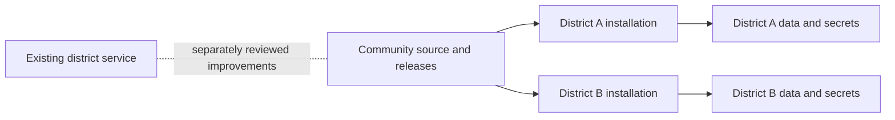

# Open-source implementation plan

Decision recorded 2026-10-15: **each district installs and controls its own instance**.

Product direction clarified 2026-10-15: **refine the existing PrivacyPal experience**. Its setup,
service cards, four-tab detail view, staff catalogue and public notice are the baseline. The local
foundation screens and eight-criterion trial prove mechanics; they are not a replacement product
design. See [the source-based design continuity proposal](design-continuity-plan.md) for the
feature map, concrete improvements and next milestone.

**Current baseline — October 22, 2026:** the clean checkout and GitHub development branch
`codex/coordinated-milestone-2026-10-19` were verified at
`186c48d505fa275e0e6eff769c4ceb6a11dbfb9f`. Local and fresh GitHub main were
`cb5bb04cde8d900f0376d11f5676369636845eae`. The three later development commits are not on main.
These identities precede this documentation consolidation; no merge, release or deployment is implied.

The review draft/retry gate, bounded/versioned evaluation storage, setup and complete-service
restoration are implemented locally. The request lifecycle foundation is now implemented: states, assignment, independent archives, private history, permissions and explicit retry reconciliation; see [request workflow](request-workflow.md). Request dashboard totals/attention queues and dedicated request destinations are implemented locally. Review/publication totals and attention queues are implemented locally; see [review dashboard](review-dashboard.md). Tier distribution and review-name/tier/queue filtering are implemented locally. Existing-review selection and current staff-guidance links are implemented locally. Create-review handoff with atomic capture/link is implemented locally. Submission catalogue suggestions remain pending. The active milestone is **dashboard and request-workflow restoration**, following
[the component parity checklist](component-parity.md). The [independent trial](independent-trial.md)
can assess the current slice, but broader workflow acceptance follows restoration. Reliability
remains the gate for expansion. Preserve [public-version improvements](public-improvements.md)
as separately reviewed backport candidates; do not change the original project.

## Product scope

Deliver a reliable tool-review workflow and a public library that a district can operate without
the original author's help. Keep the original district service running independently throughout.

The first release should support:

1. A district administrator bootstraps an empty installation and assigns reviewer/staff roles.
2. Staff search the approved catalogue and request a tool when needed.
3. Reviewers collect a privacy policy or paste source text, inspect extracted findings and evidence,
   and receive a deterministic score calculated from a versioned rubric.
4. A human records the district's decision, conditions of use, and publication choice.
5. Families see an accessible, searchable library containing only approved public fields.
6. District administrators can export, back up, restore, upgrade, and hand over the installation.

**Owner decision, October 22:** DPA document generation, signing, vendor upload and delivery are
excluded from restoration; districts will use other methods for legal documents. Gmail/Drive
integrations unrelated to that excluded workflow, automated policy monitoring and cross-district
sharing remain later modules. Their current implementations add permissions,
operational costs, and review work that should not block a trustworthy first release.
This does not defer manual DPA status, tier requirements, conditions of use, or their display in
service details; those are part of preserving the existing review experience.

## Isolation and architecture

Use this repository as the community development line. Maintain the original repository and
deployment separately. A useful improvement may later be proposed to the district as a small,
reviewed patch with its own validation and deployment decision. There is no automatic backport.

For the first implementation, retain React/TypeScript and provision a separate Firebase project
for each district. This preserves useful existing work while putting data and credentials under
district control. Revisit the backend if the adoption pilot shows that cost or setup burden is
unacceptable; a backend replacement should have evidence behind it.

No shared production database, shared AI key, inherited deployment target, or shared user directory.
No telemetry, outbound mail, or live AI is required for local development. Local smoke tests use
synthetic data, emulators, and a deterministic fake model adapter.

Use a stable district/workspace identity with explicit membership. Avoid making the long-term
owner of district records an individual employee's login UID. Keep deployment configuration,
district policy settings, and secrets separate. Domain hints in the login UI are not authorization.

Model calls belong on the server. The browser submits an authorized job and observes its status;
the server owns retries, cancellation, limits, evidence capture, and result persistence. Provider
credentials never cross the browser boundary. Record the rubric, prompt, schema, and model
versions alongside each result so changes can be evaluated and explained.

## What to keep, change, and defer

| Area | Direction | Reason |
| --- | --- | --- |
| Deterministic rubric/scoring | Preserve and extract behind a pure interface | Reproducible decisions are a strength; retain the regression net. |
| Source provenance and confidence | Preserve and make visible | Missing policy evidence must not silently become certainty. |
| Human overrides | Preserve with attributed history | Re-analysis must not erase district decisions. |
| Public/staff/private projections | Preserve separation, strengthen write guarantees | Families should never receive full internal records. |
| Identity, roles, bootstrap | Rebuild as explicit authorization | A new district must initialize safely without client-controlled ownership. |
| Browser AI execution | Replace with server jobs | Protect credentials, bound cost, survive closing a tab. |
| Persistence and publication | Make atomic or acknowledged/reconciled | An unpublish action must not report success while an old notice remains public. |
| District constants and domains | Configuration, validated once | New adopters must not edit production IDs in scattered files. |
| Minnesota-specific wording and tier policy | Versioned, configurable policy profile | Do not present one district's policy as a universal legal conclusion. |
| DPA/email/Drive | Optional later modules | Require separate security, consent, and lifecycle review. |
| Historical fixtures and operational notes | Keep private; author synthetic replacements | Preserve useful tests without distributing district records. |
| Legacy deployment scripts | Replace | They must have no default path to existing district resources. |

## Milestones and acceptance criteria

### 0. Establish an auditable starting point

- [x] Verify the actual source and destination repositories.
- [x] Pin the upstream revision and preserve a local snapshot without its Git history.
- [x] Establish the district boundary in AGENTS.md and ignore private reference material.
- [x] Run upstream offline checks and its existing rules suite.
- [x] Record source-level security, portability, and reliability findings privately.
- [x] Confirm the self-hosted ownership model with the user.

### 1. Create a safe, district-neutral application foundation — local slice implemented

- [x] Build a district-neutral local shell with synthetic fixtures; preserve upstream license/provenance.
- [x] Provide validated configuration examples, no production fallback, and a clear setup screen.
- [x] Run Auth, Firestore, and a local Node API against explicit demo projects.
- [x] Establish operator-only initial admin setup and explicit staff/viewer/reviewer/admin roles.
- [x] Replace broad rules with role/field validation and negative authorization tests.
- [x] Pin a reviewed Node 24 toolchain and lockfile; dated audit evidence and development CLI exceptions are in `dependencies.md` (not a new dependency audit).
- [x] Gate source/bundle scanning and emulator integration tests in CI. Block deployment entirely for this local milestone.

**Done when:** a fresh clone can be installed, tested, and started with no cloud credentials; a second
synthetic district config works; neither setup references the original district; access tests reject
unrelated users, forged ownership, privilege changes, and unauthorized public fields.

### 2. Deliver the core review-to-publication workflow — local workflow implemented; live boundaries pending

- [x] Pin deterministic scoring with synthetic regression fixtures and versioned definitions.
- [x] Persist authorized synthetic jobs and segmented attempts with bounded storage and receipts.
- [x] Validate supported structured outputs and exact citations; preserve human corrections.
- [x] Separate findings, calculated scores, district decisions and public wording.
- [x] Commit publication/removal consistently with private state and attributed history.
- [x] Support practice draft import/export and whole-installation recovery; newer inspection archives require explicit recapture.
- [ ] Qualify live provider execution, bounded outbound retrieval and semantic interpretation.

**Done when:** a reviewer can submit a synthetic policy, recover from a failed job, inspect its evidence,
approve it, publish it, and unpublish it. Closing/reopening the browser does not lose the job. A failure
to remove a public record is visible and cannot be mistaken for a completed unpublish.

**Manual acceptance recorded 2026-10-15:** the project owner completed sign-in, synthetic policy
review, publication and unpublication in the local browser. Automated permission and recovery
checks are documented separately in `provenance.md`.

### 3. Prove operability with an independent pilot

- Document new-project provisioning, required APIs/permissions, provider setup, and expected cost drivers.
- Verify keyboard navigation, screen readers, arbitrary district colors, zoom, mobile layout, and embeds.
- Test backup/restore, schema upgrades, rollback, admin turnover, and secret rotation in a disposable project.
- Give one participating district the instructions and record where it needs help.
- Resolve release-blocking findings and test the core workflow in its separate environment.

**Done when:** an adopter can install and operate the software without relying on the author's accounts,
and the backup/restore and upgrade procedures have actually succeeded with synthetic records.

### 4. Publish the first supported release

- Review source, fixtures, history, license/attribution, and third-party material for publication.
- Provide README, installation guide, CONTRIBUTING, SECURITY reporting instructions, changelog, and support scope.
- Record known limitations, supported policy profiles, and how AI assistance differs from district approval.
- Publish a tagged release only after the previous milestones pass. Repository visibility is a separate,
  deliberate action; this audit did not make either repository public.

## Adoption promises to make carefully

“Free” describes the software license. Cloud hosting, AI inference, mail delivery, storage, and staff
time are operating costs. Measure a small district pilot before promising a monthly cost or free tier.

The application assists review and records decisions; it should not promise a legal compliance
certification. Policy text, consent wording, and jurisdiction coverage need separate qualified review.
This plan does not adopt the legal claims in the old UI or documentation.

## Current implementation and remaining work

This is the current status index. Historical proposals and milestone reports retain their dates;
they must not be used as a current assignment list. “Implemented locally” means synthetic emulator
support, not production readiness, independent acceptance or district policy approval.

| Area | Implemented and recorded evidence | Still pending |
| --- | --- | --- |
| District setup and service experience | Versioned setup/library settings, reviewer cards, four tabs, manual agreement facts and separate staff/family projections. See [service detail](service-detail.md). | Owner acceptance of the refined interface, broader tag/batch workflows and independent user acceptance. |
| Review reliability | Tab-scoped review drafts, actor-scoped retry receipts, immutable source/evaluation context, bounded findings/history, deterministic scoring and atomic publication withdrawal. See [review workflow](review-workflow.md) and [storage](review-storage.md). | Equivalent durable draft/retry guarantees for settings and internal notes; production-scale validation. Settings navigation retention alone is not full draft recovery. |
| Document coverage | Pasted document sets, dependency/exclusion editor, long sources, explicit range acknowledgments and unresolved coverage gates. | Automatic retrieval/discovery and evidence interpretation qualification. |
| Segmented assistance | Durable Lantern synthetic runs, retained original bytes/attempts, explicit unresolved human handoff and schema-10 recovery. See [segmented reviews](segmented-reviews.md). | Live adapters, general output adoption, settlement/billing reconciliation and enforced provider token/spend limits. Offline packets remain inspection artifacts. |
| Rubric | Versioned practice/full definitions, selectable 14-measure precision pilot, and a separate three-measure offline proposal. | Independent labels/holdouts, district normative decisions and remaining precision coverage. Agent review is not human adjudication. |
| Installation | Own-dependency fresh-clone River Valley rehearsal, bootstrap, role denials, backup/restore and startup diagnostics. | An outside person's browser trial on another machine, including prerequisite/download friction. |
| Accessibility and public delivery | Keyboard/error-focus/draft/320px/200% browser checks and build-size budgets. | Spoken VoiceOver/NVDA checks, broader contrast/modes/400% coverage and public startup independent of private API health. |
| Operations | Verified local archives, legacy conversion, two schema-10 recovery cycles and a read-only operator check. | Protected-admin succession, total-admin-loss recovery, encrypted off-device custody, supported A/B upgrade/rollback and production operations. |

### Evidence boundary

The [October 20 adoption-wave report](parallel-work/reports/coordinator-adoption.md) records
544 unit/isolation tests, TypeScript/build/bundle/isolation, 224 emulator integration tests,
a schema-9 fixture import and two schema-10 shutdown/import cycles passing. The fresh trial was
operated by the implementation team on a Mac with Node/Java and emulator caches already installed.
Native Chrome acceptance was focused; it did not test screen-reader speech. These suites were
not rerun for the October 22 documentation consolidation. Test totals are historical observations,
not future acceptance thresholds. A new candidate must pass its own applicable checks.

Current handoff: implemented changes through `67af343` are committed and pushed on the development
branch. Latest recorded implementation checks passed 552 unit/isolation and 240 integration tests;
see [HANDOFF](../HANDOFF.md) for precise evidence and limits. At the October 26 wrap-up, the synthetic
preview was running and a schema-11 archive was saved and verified, including the new QA request.
The private recovery path and temporary runtime details are in HANDOFF. A fresh adopter must create
their own installation and backup, not use that private archive.

### Ordered work plan

1. **Baseline consolidation — complete for this checkpoint.** Use this status index, the dated
   handoff and the trial checklist. Preserve historical evidence. Review actual branch changes
   and candidate checks before any separately authorized main integration.
2. **Request handoff and integrated acceptance — next implementation.** Dashboard totals/filtering,
   lifecycle queues, existing-review selection and staff-guidance links are implemented locally. Complete
   create-review handoff, submission suggestions and the remaining requester outcome gates in [component parity](component-parity.md). Independent end-to-end acceptance remains pending. DPA document automation is intentionally excluded.
3. **Independent local acceptance — pending.** An outside participant uses a fresh source checkout
   and synthetic accounts on another machine. Record each trial step, assistance, failure and retest.
   Completion requires the core checklist, not only automated tests. Extend it with the P1 request/dashboard
   walkthrough before claiming restored-workflow acceptance.
4. **Accessibility and rubric acceptance — pending; may proceed alongside the trial.** Exercise
   spoken assistive technology and configurable visual states. Obtain independent rubric judgments
   and named district policy decisions before extending accepted precision coverage.
5. **Operational continuity — pending.** Resolve succession authority/configuration compatibility,
   then implement and rehearse transfer, revocation, encrypted off-device recovery and a named
   supported upgrade/rollback pair. Existing restore cycles are not an upgrade certification.
6. **Hosted/provider pilot — separately scoped.** Qualify retrieval, adapters, cost/settlement,
   identity, public delivery and infrastructure before live enablement. Decide support and private
   vulnerability reporting before a supported release.

The existing district service and original repository remain outside this work. Main merge,
provider calls, publication to a hosted service, release and deployment are separate decisions.
