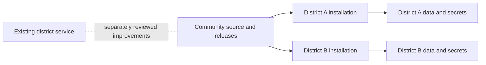

# Open-source implementation plan

Decision recorded 2026-10-15: **each district installs and controls its own instance**.

## Product scope

Deliver a reliable tool-review workflow and a public library that a district can operate without
the original author's help. Keep the original district service running independently throughout.

The first release should support:

1. A district administrator bootstraps an empty installation and assigns reviewer/staff roles.
2. Staff search the approved catalogue and request a tool when needed.
3. Reviewers collect a privacy policy or paste source text, inspect extracted findings and evidence,
   and receive a deterministic score calculated from a versioned rubric.
4. A human records the district's decision, conditions of use, and publication choice.
5. Families see an accessible, searchable library containing only approved public fields.
6. District administrators can export, back up, restore, upgrade, and hand over the installation.

DPA generation/signature collection, Gmail/Drive integrations, automated policy monitoring,
and cross-district sharing are later modules. Their current implementations add permissions,
operational costs, and review work that should not block a trustworthy first release.

## Isolation and architecture

Use this repository as the community development line. Maintain the original repository and
deployment separately. A useful improvement may later be proposed to the district as a small,
reviewed patch with its own validation and deployment decision. There is no automatic backport.

For the first implementation, retain React/TypeScript and provision a separate Firebase project
for each district. This preserves useful existing work while putting data and credentials under
district control. Revisit the backend if the adoption pilot shows that cost or setup burden is
unacceptable; a backend replacement should have evidence behind it.

No shared production database, shared AI key, inherited deployment target, or shared user directory.
No telemetry, outbound mail, or live AI is required for local development. Local smoke tests use
synthetic data, emulators, and a deterministic fake model adapter.

Use a stable district/workspace identity with explicit membership. Avoid making the long-term
owner of district records an individual employee's login UID. Keep deployment configuration,
district policy settings, and secrets separate. Domain hints in the login UI are not authorization.

Model calls belong on the server. The browser submits an authorized job and observes its status;
the server owns retries, cancellation, limits, evidence capture, and result persistence. Provider
credentials never cross the browser boundary. Record the rubric, prompt, schema, and model
versions alongside each result so changes can be evaluated and explained.

## What to keep, change, and defer

| Area | Direction | Reason |
| --- | --- | --- |
| Deterministic rubric/scoring | Preserve and extract behind a pure interface | Reproducible decisions are a strength; retain the regression net. |
| Source provenance and confidence | Preserve and make visible | Missing policy evidence must not silently become certainty. |
| Human overrides | Preserve with attributed history | Re-analysis must not erase district decisions. |
| Public/staff/private projections | Preserve separation, strengthen write guarantees | Families should never receive full internal records. |
| Identity, roles, bootstrap | Rebuild as explicit authorization | A new district must initialize safely without client-controlled ownership. |
| Browser AI execution | Replace with server jobs | Protect credentials, bound cost, survive closing a tab. |
| Persistence and publication | Make atomic or acknowledged/reconciled | An unpublish action must not report success while an old notice remains public. |
| District constants and domains | Configuration, validated once | New adopters must not edit production IDs in scattered files. |
| Minnesota-specific wording and tier policy | Versioned, configurable policy profile | Do not present one district's policy as a universal legal conclusion. |
| DPA/email/Drive | Optional later modules | Require separate security, consent, and lifecycle review. |
| Historical fixtures and operational notes | Keep private; author synthetic replacements | Preserve useful tests without distributing district records. |
| Legacy deployment scripts | Replace | They must have no default path to existing district resources. |

## Milestones and acceptance criteria

### 0. Establish an auditable starting point

- [x] Verify the actual source and destination repositories.
- [x] Pin the upstream revision and preserve a local snapshot without its Git history.
- [x] Establish the district boundary in AGENTS.md and ignore private reference material.
- [x] Run upstream offline checks and its existing rules suite.
- [x] Record source-level security, portability, and reliability findings privately.
- [x] Confirm the self-hosted ownership model with the user.

### 1. Create a safe, district-neutral application foundation — local slice implemented

- [x] Build a district-neutral local shell with synthetic fixtures; preserve upstream license/provenance.
- [x] Provide validated configuration examples, no production fallback, and a clear setup screen.
- [x] Run Auth, Firestore, and a local Node API against explicit demo projects.
- [x] Establish operator-only initial admin setup and explicit staff/viewer/reviewer/admin roles.
- [x] Replace broad rules with role/field validation and negative authorization tests.
- [x] Pin a reviewed Node 24 toolchain and lockfile; runtime audit is clean, development CLI exceptions documented.
- [x] Gate source/bundle scanning and emulator integration tests in CI. Block deployment entirely for this local milestone.

**Done when:** a fresh clone can be installed, tested, and started with no cloud credentials; a second
synthetic district config works; neither setup references the original district; access tests reject
unrelated users, forged ownership, privilege changes, and unauthorized public fields.

### 2. Deliver the core review-to-publication workflow — local synthetic slice implemented

- Extract and pin the deterministic scoring engine using new synthetic golden fixtures.
- Implement server-side analysis jobs with authorization, quotas, bounded fetches, and durable state.
- Treat fetched pages and model output as untrusted input; validate structured output and citations.
- Keep facts, calculated scores, administrative decisions, and public wording separate.
- Save primary records and publication state with verifiable consistency and useful failure feedback.
- Provide export/import and an append-only server-attributed review history.

**Done when:** a reviewer can submit a synthetic policy, recover from a failed job, inspect its evidence,
approve it, publish it, and unpublish it. Closing/reopening the browser does not lose the job. A failure
to remove a public record is visible and cannot be mistaken for a completed unpublish.

**Manual acceptance recorded 2026-10-15:** the project owner completed sign-in, synthetic policy
review, publication and unpublication in the local browser. Automated permission and recovery
checks are documented separately in `provenance.md`.

### 3. Prove operability with an independent pilot

- Document new-project provisioning, required APIs/permissions, provider setup, and expected cost drivers.
- Verify keyboard navigation, screen readers, arbitrary district colors, zoom, mobile layout, and embeds.
- Test backup/restore, schema upgrades, rollback, admin turnover, and secret rotation in a disposable project.
- Give one participating district the instructions and record where it needs help.
- Resolve release-blocking findings and test the core workflow in its separate environment.

**Done when:** an adopter can install and operate the software without relying on the author's accounts,
and the backup/restore and upgrade procedures have actually succeeded with synthetic records.

### 4. Publish the first supported release

- Review source, fixtures, history, license/attribution, and third-party material for publication.
- Provide README, installation guide, CONTRIBUTING, SECURITY reporting instructions, changelog, and support scope.
- Record known limitations, supported policy profiles, and how AI assistance differs from district approval.
- Publish a tagged release only after the previous milestones pass. Repository visibility is a separate,
  deliberate action; this audit did not make either repository public.

## Adoption promises to make carefully

“Free” describes the software license. Cloud hosting, AI inference, mail delivery, storage, and staff
time are operating costs. Measure a small district pilot before promising a monthly cost or free tier.

The application assists review and records decisions; it should not promise a legal compliance
certification. Policy text, consent wording, and jurisdiction coverage need separate qualified review.
This plan does not adopt the legal claims in the old UI or documentation.

## Current implementation and next slice

The local foundation now includes a public sample library, sign-in, team access management, pending
tool requests, and role-gated internal notes. It uses a local Node API instead of deploying Cloud
Functions; deployment and live AI are deliberately unavailable in this milestone. See
`local-development.md`, `permissions.md`, and `dependencies.md` for setup, guarantees, and limits.

The local milestone 2 slice adds a pure versioned score engine, synthetic golden fixtures, persistent
emulator jobs, attributed decisions/history, atomic publication/removal, and export/import as drafts.
See `review-workflow.md` for the complete flow and limits. The next local slice adds a technically reviewed, versioned evidence-first rubric candidate,
operator installation snapshots with write fencing and integrity checks, two full recovery cycles,
and an independent local trial guide. See `scoring-rubric.md`, `backup-recovery.md`, and
`independent-trial.md`. These complete the local backup/recovery rehearsal, not milestone 3's
independent district pilot. Real-policy extraction, district policy sign-off, bounded outbound
retrieval, production provisioning, accessibility verification, encrypted retention and schema
upgrade/rollback remain ahead.
The original district repository, source snapshot, and deployment remain unchanged.
